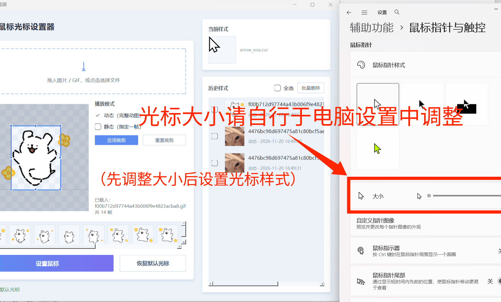
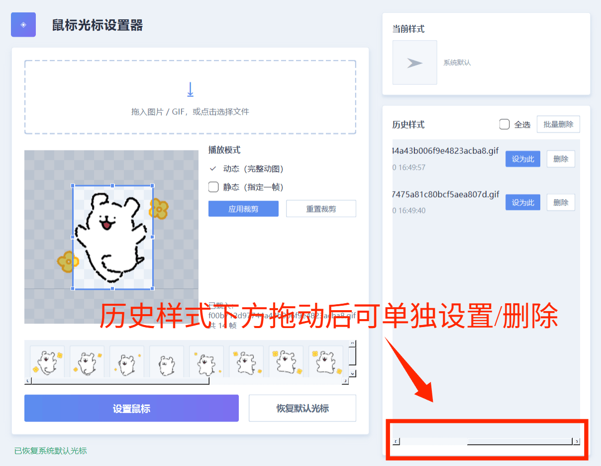

# 鼠标光标设置器（Cursor Customizer）

拖入已抠好的图片 / GIF 动图，一键把 Windows 鼠标指针换成对应样式；支持窗内裁剪、选帧、历史样式复用，一键恢复系统默认光标。

> 本项目 **免费开源**，仅供学习与个人使用，**禁止商用**。

## 界面预览

主界面：拖入素材、裁剪、选择动态 / 静态帧，右侧显示当前样式与历史样式。



历史样式：每次成功设置都会自动存入历史，可单独「设为此」「删除」，也可勾选后批量删除。



## 功能

- **拖入 / 上传素材**：支持 PNG / JPG / JPEG / BMP / WEBP / ICO 图片，以及 GIF 动图。
- **窗内裁剪**：预览图内有裁剪框（默认铺满整张图），可拖动框体移动位置，也可拖动八个手柄（四角 + 四边中点）调整裁剪范围；「应用裁剪」按框裁切，「重置裁剪」恢复原始素材。
- **动态 / 静态切换**
  - 仅当素材为多帧 GIF 动图时，播放模式才可选；单张静态图自动置灰。
  - 动态：完整帧序列打包为 Windows 动画光标（ANI）。
  - 静态：拖动滑块或点击缩略帧，选择其中一帧生成静态光标（CUR）。
- **当前样式**：右侧小窗显示当前生效的光标样式与名称。
- **历史样式**：每次成功设置自动存入历史；支持单个删除、勾选后批量删除、「设为此」一键复用。
- **一键设置 / 恢复**：自动转换并写入系统鼠标样式即时生效；恢复时还原为打开软件前的原样式，备份丢失时也会回退系统默认箭头。

## 运行方式

### 方式一：EXE 直接运行（推荐，无需安装环境）

在 Releases 中下载 `CursorCustomizer.exe`，双击即可运行，无需安装 Python 或任何依赖。

### 方式二：源码运行

1. 安装 **Python 3.10 及以上版本**（安装时勾选 *Add Python to PATH*）。
2. 在项目目录打开命令行，安装依赖：

   ```bash
   pip install -r requirements.txt
   ```

3. 启动程序：

   ```bash
   python main.py
   ```

## 从源码打包单文件 EXE

双击 `build_exe.bat`，或手动执行：

```bash
pip install pyinstaller
pyinstaller --noconfirm CursorCustomizer.spec
```

产物位于 `dist\CursorCustomizer.exe`（约 27MB），双击即用。

## 数据存放位置

缓存光标、备份与历史记录保存在用户目录（自动多级兜底，只读目录 / 受限账户下也可写入）：

1. `%LOCALAPPDATA%\CursorCustomizer\`
2. 兜底 `%USERPROFILE%\.CursorCustomizer\`
3. 再兜底系统临时目录 `%TEMP%\CursorCustomizer\`

## 使用步骤

1. 把素材拖入虚线框，或点击框内选择文件。
2. 需要裁剪时在预览图上拖拽框选，点「应用裁剪」；多帧素材选择动态或静态帧。
3. 点击 **设置鼠标**，移动鼠标查看效果；该样式自动进入历史列表。
4. 历史列表可勾选批量删除、单个删除，或点「设为此」复用旧样式。
5. 需要还原时点击 **恢复默认光标**。

## 注意事项

- **杀毒软件 / Windows SmartScreen 拦截**：未做商业数字签名，首次运行 EXE 时可能出现「Windows 已保护你的电脑」或杀毒软件提示。点击「更多信息 → 仍要运行」，或在杀毒软件中添加信任即可；软件源码全部开放，可自行审查或用源码运行。
- **素材请提前抠好透明背景**；不透明素材会以矩形方块作为光标。
- **光标大小由系统控制**：软件本身不提供尺寸选项，请在 Windows「设置 → 辅助功能 → 鼠标指针与触控 → 大小」中调整指针大小，建议先调好大小再设置光标样式（见主界面截图）。
- 仅替换普通选择箭头（Arrow）；其余系统光标保持原样。
- 仅支持 Windows 系统；部分锁屏 / 远程桌面 / 游戏环境下光标样式可能被覆盖，属系统行为。
- 视频文件（MP4 / AVI 等）暂不支持直接导入，请先转为 GIF 后再使用。

## 技术说明

- 静态光标：PIL 生成 ICO 结构后改写为 CUR（type=2），热点默认位于中心。
- 动态光标：手写 RIFF / ANIH 容器生成 ANI，帧为 CUR 序列；GIF 按原帧间隔播放。
- 系统写入：注册表 `HKCU\Control Panel\Cursors` + `SystemParametersInfo(SPI_SETCURSORS)` 刷新。
- 备份：首次设置前自动备份当前各光标原值；恢复后自动清除备份。
